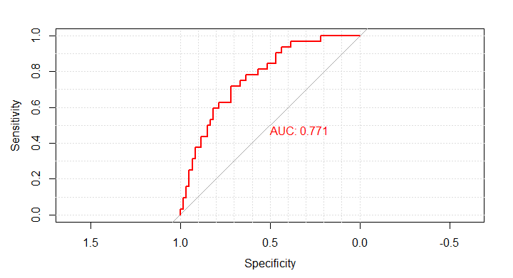
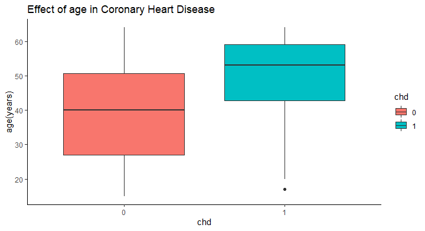
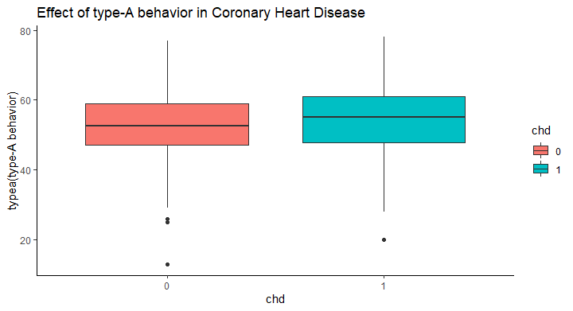

# Coronary Heart Disease Prediction (SAheart)

[](code/heart_disease_analysis.R)
[](LICENSE)
[](data/README.md)

Predicting coronary heart disease from nine risk factors in the **Coronary Risk-Factor Study (SAheart)** data, comparing logistic regression, linear discriminant analysis (LDA), quadratic discriminant analysis (QDA) and Naive Bayes. The project also covers the theory behind the methods: the curse of dimensionality, bias–variance trade-offs, and hand-derived neural-network decision boundaries.

## Key Results

- **Test ROC AUC: 0.7708** — well above the 0.5 chance level.
- **Logistic regression:** five significant risk factors — **tobacco, LDL cholesterol, family history (Present), type-A behaviour, and age**. Stepwise selection by AIC reduced the full model (AIC 398.03) to a 5-variable model (AIC 392.49).
- **Test-set accuracy:** QDA **70.7%** (65/92), LDA **65.2%** (60/92). On the test set LDA classified every case as no-CHD, while QDA correctly identified 17 of 32 CHD cases.
- **Data:** 462 males aged 15–64 from a heart-disease high-risk region of the Western Cape, South Africa; 80% train (370) / 20% test (92), `set.seed(123)`.
- **Class balance (training):** 65.4% no-CHD / 34.5% CHD.



*ROC curve on the test set (AUC 0.771). The closer the curve is to the upper-left corner, the better the classifier.*

## Data

- **Source:** SAheart data set (Stanford / *Elements of Statistical Learning*), see [`data/README.md`](data/README.md)
- **Response:** `chd` — coronary heart disease (present / absent)
- **Predictors (9):** `sbp` (systolic blood pressure), `tobacco` (cumulative tobacco, kg), `ldl` (low-density lipoprotein cholesterol), `adiposity`, `famhist` (family history of heart disease), `typea` (type-A behaviour), `obesity`, `alcohol` (current alcohol consumption), `age`
- **Split:** 80% train (370) / 20% test (92), `set.seed(123)`

## Methods

The project has three parts:

1. **Theory — the curse of dimensionality:** hypercube edge length, nearest-neighbour distances in high dimensions, the bias–variance decomposition for k-NN, and how feature selection (low-variance / high-correlation filters, VIF, CART ranking) and feature extraction (PCA, factor analysis, ICA) mitigate it.
2. **Neural-network decision boundaries:** hand-derived weights for two linear boundaries (x₁ = 3 and 2x₁ + x₂ − 5 = 0), verified with sample points.
3. **SAheart analysis:**
   - Logistic regression with `glm()` and backward stepwise selection by AIC (`stepAIC`)
   - Linear discriminant analysis (LDA), quadratic discriminant analysis (QDA) and Naive Bayes on centred-and-scaled data
   - Exploratory boxplots and scatterplots (ggplot2)
   - Test-set evaluation with ROC curves (pROC)

## Results

- **Logistic regression:** five significant risk factors — **tobacco, ldl, family history (Present), type-A behaviour, and age**. Full-model AIC 398.03 vs 392.49 for the selected 5-variable model (lower AIC = more parsimonious).
- **Class balance (training):** 65.4% no-CHD / 34.5% CHD.
- **Test ROC AUC: 0.7708** — well above the 0.5 chance level.
- **Test-set confusion:** LDA predicted all 92 test cases as no-CHD (60 correct, 32 CHD cases missed); QDA predicted 48 no-CHD and 17 CHD cases correctly, for 70.7% accuracy.
- **Assumption violations noted in the report:** logistic regression assumes linearity in the log-odds; LDA/QDA assume normally distributed predictors (age, tobacco, alcohol are not normal); Naive Bayes assumes independent predictors (several are strongly correlated).

### Exploratory plots



*Age vs CHD: the chance of coronary heart disease rises with age, markedly from around age 50.*



*Type-A behaviour vs CHD: CHD cases have slightly higher type-A behaviour scores.*

## How to Run

```r
# Install required packages first (once):
# install.packages(c("caret", "MASS", "ggplot2", "naivebayes", "pROC", "dplyr"))

source("code/heart_disease_analysis.R")
```

The script downloads the SAheart data directly from Stanford, so no data file is needed. It reproduces the split, the logistic model and stepwise selection, the boxplots, the LDA/QDA/Naive Bayes fits, the test-set predictions and the ROC curve.

## Files

| Path | Contents |
|---|---|
| `report/Heart_Disease_Report.docx` | Full project report (Word, master copy) |
| `report/Heart_Disease_Report.pdf` | PDF export of the report |
| `code/heart_disease_analysis.R` | Standalone R script extracted from the report appendix and cleaned up to run as-is |
| `data/README.md` | Data source link (no data file committed) |
| `images/` | Figures extracted from the report: ROC curve and exploratory boxplots |

## Notes

- The R script was cleaned up from the appendix of the original report: the user-specific `setwd()` path and a broken `train.mat` line were removed, the repeated `heart$chd <- factor(...)` conversions were consolidated into one, `<<-` global assignments were replaced with `<-`, and duplicated blocks (QDA predictions, `contrasts()` calls) were de-duplicated. The analysis, data source, seed and results are unchanged.

## License

MIT — see [LICENSE](LICENSE).
